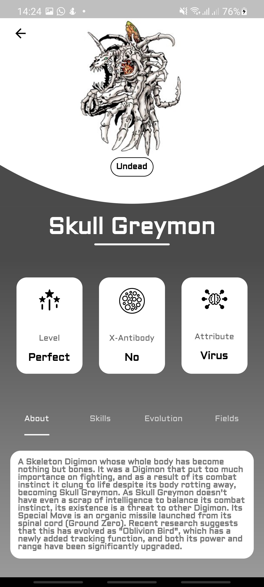

# Digidexplus

A Flutter based Digimon encyclopedia

This project is an open source digimon encyclopedia. The app uses the [Digi-API](https://digi-api.com/) (`https://digi-api.com/api/v1`) to display a list of digimon and the details of each.

## Purpose
The purpose of this project is to practice "best practices" with regards to building an app. so we're talking about things like:

- unit testing
- bloc/provider design patterns
- separation of concerns
- dependency injection etc

Though the API is not extensive i believe this is a project that can incorporate various ideas and as such it would be great to have anyone interested in getting involved in improving the app to participate and contribute.

## Screenshot


## Project structure
- `lib/data/` – `DigimonRepository`, the only place that talks to the API (through the Retrofit `RestClient` in `lib/utils/rest_client.dart`) and builds colour palettes.
- `lib/viewmodels/` – Provider `ChangeNotifier`s for the list and for search. They get the repository injected, so tests use a fake one.
- `lib/views/`, `lib/components/` – the screens and widgets.
- `lib/ads/`, `lib/config/ad_config.dart` – AdMob banners and interstitials.

## Getting started
Needs Flutter 3.35 or newer (Dart 3.9+). The Android app targets API 36 (Android 16), which Google Play requires for updates since August 2026, so the Android SDK needs platform 36 and Build Tools 36.

```bash
flutter pub get
flutter test
flutter run
```

After changing `lib/utils/rest_client.dart`, regenerate the client with `dart run build_runner build`.

## Search
The API's `name` filter only matches the start of a word in the base name ("blue" doesn't find "Greymon (Blue)"), so the app fetches the full list once (~220 KB) and searches it on the device: case, punctuation and spacing are ignored, and `#001` finds by number. Level chips use the API's `level` filter, fetched once per level.

## Sounds
`assets/sounds/card_tick.wav` and `card_draw.wav` were synthesised for this app (no third-party audio). They play alongside other audio without taking focus, and respect the iOS silent switch.

## Ads
The app shows AdMob banners and an occasional interstitial, after Google's consent form for users who need one (EEA/UK; set up the message under Privacy & messaging in AdMob). Release builds use the real DigiDexPlus ad units; debug builds always use Google's **test** ids, so testing never serves real ads. Interstitials show at most every 5 details screens and never within 90 seconds of the last one (`lib/config/ad_config.dart`). To check ads on a phone with a release build, use Google's test units: `flutter build apk --release --dart-define=ADMOB_USE_TEST_UNITS=true`. The ids live in:
- `lib/config/ad_config.dart` (ad units)
- `android/app/src/main/AndroidManifest.xml` (`com.google.android.gms.ads.APPLICATION_ID`)
- `ios/Runner/Info.plist` (`GADApplicationIdentifier`, still a test id: there is no iOS app in AdMob yet)

## Notes
The list of digimon is made possible with a class called the StackedListView. All credits go to [gzlock](https://github.com/gzlock/flutter_stacked_listview) for this list view ([stacked_listview](https://pub.dev/packages/stacked_listview) on pub.dev). I couldn't use the package because it has a bug that affected the listing of items, so I copied the code into `lib/components/stacked_list.dart` and fixed it myself.

## Download
The app will also be available soon on the Google playstore
